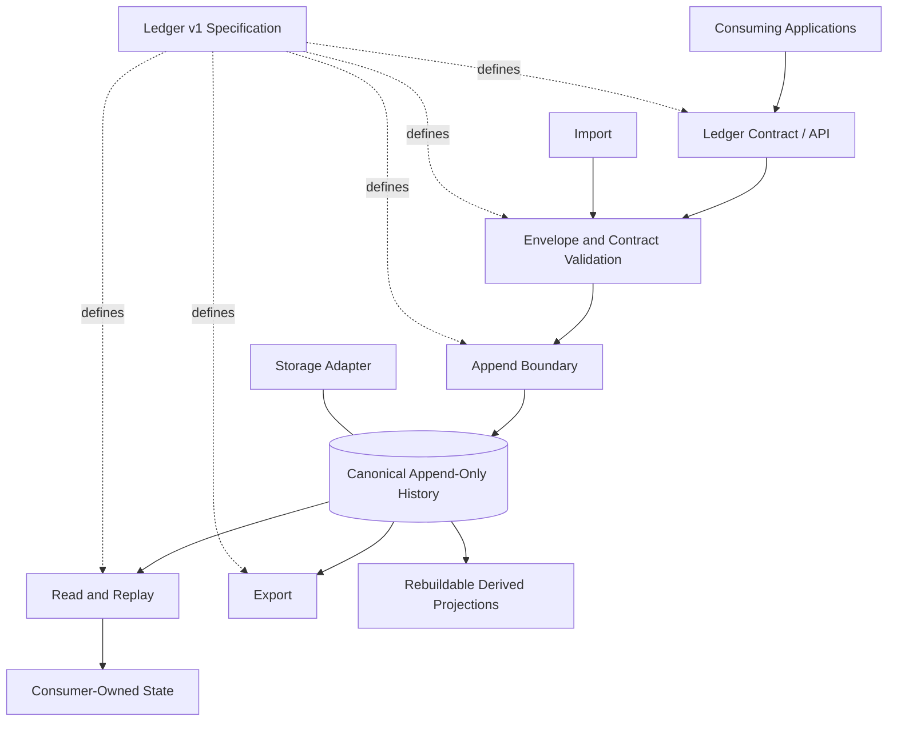

# Ledger Architecture Overview

**Status:** Foundational architecture  
**Specification:** [Ledger v1](../specification/v1.md)

## 1. Purpose

Ledger provides a portable, immutable history from which independent applications can validate records, replay changes, and reconstruct application-owned persistent state.

Ledger owns the history and the rules for interpreting its portable envelope. A consuming project owns the meaning of its domain events and the shape of its reconstructed state.

## 2. Architectural boundaries

### 2.1 Specification

The language-neutral specification defines externally observable behavior: record structure, append semantics, ordering, validation, replay, API behavior, version negotiation, and interchange.

The specification is authoritative. An implementation must not make an undocumented behavior part of the contract.

### 2.2 Canonical history

The canonical history is the authoritative source of truth. Accepted records are immutable and are never updated or deleted through the Ledger contract.

A successful append establishes a durable record and its ledger-assigned ordering position. The exact physical representation is implementation-defined.

### 2.3 Record contract

A record has a Ledger-defined envelope and a consumer-defined payload. The envelope supplies identity, ownership namespace, stream identity, event type, schema version, timestamps, and ordering information.

Payloads are opaque to Ledger beyond the validation rules explicitly defined by the specification. Ledger does not impose another project's domain schema.

### 2.4 Append and read services

The append boundary validates and accepts new records. The read boundary exposes records by identity, stream, and ledger position.

Append operations must provide a clear success/failure result and must not silently rewrite accepted history.

### 2.5 Replay

Replay reads canonical records in their defined order and makes them available to a consumer or consumer-supplied handler. Ledger defines ordering and pagination; the consumer defines how its own state changes in response to each event.

Replay must be repeatable against the same immutable record range. A consumer is responsible for making its projection/reducer deterministic if it requires identical reconstructed state.

### 2.6 Validation

Validation covers the Ledger envelope, required fields, supported representation version, record identity, ordering constraints, and integrity metadata where defined.

Domain-payload validation is opt-in and schema-driven. Ledger must not pretend to understand arbitrary consumer payloads.

### 2.7 Import and export

Interchange uses documented, versioned representations. Export preserves record content and source identity/order metadata. Import validates the representation and supports safe repeat attempts without duplicating records.

Interchange is independent of the source and destination storage engines.

### 2.8 Storage adapter

The storage adapter is an implementation boundary, not a public contract. It may use a relational database, embedded database, files, or another suitable persistence mechanism.

No consumer may depend on a Ledger implementation's tables, columns, indexes, file layout, or storage-specific identifiers.

### 2.9 Derived projections

Indexes, caches, search structures, materialized views, and other projections are derived from canonical history. They may be discarded and rebuilt.

A projection is never the canonical record history and must not be the only surviving copy of accepted data.

## 3. Conceptual architecture

The diagram is logical. It does not prescribe process boundaries, deployment topology, database products, or an internal class structure.

## 4. Versioning

There is one cohesive Ledger specification version.

- API routes use `/api/v1/`.
- Representations use versioned media types.
- The API version and representation version are related but distinct signals.
- Compatible additions may be made within v1 only when existing v1 clients can safely ignore or handle them under the rules in the specification.
- A breaking change to a normative contract requires v2.
- An implementation language or storage migration does not create a new specification version.

The initial media type family is defined in the v1 specification. Implementations must not invent private version aliases.

## 5. Explicit non-goals

Ledger does not require or provide:

- Kafka, a message broker, a broker cluster, or broker-specific clients.
- Distributed consensus or multi-region replication.
- A workflow or orchestration engine.
- A domain-specific event taxonomy.
- A shared database schema between consuming projects.
- A mandated database, ORM, programming language, or deployment model.
- A requirement that every consumer use Ledger as its live application database.

These capabilities may be built around Ledger by other systems, but they are not prerequisites for Ledger itself.

## 6. Implementation sequencing

1. Review and stabilize the v1 specification.
2. Define conformance tests from the normative requirements.
3. Implement the first adapter and API in Python.
4. Validate portability with an independent Java implementation.
5. Add storage implementations only when they satisfy the same contract.

The implementations are interchangeable realizations of the specification, not competing definitions of it.
